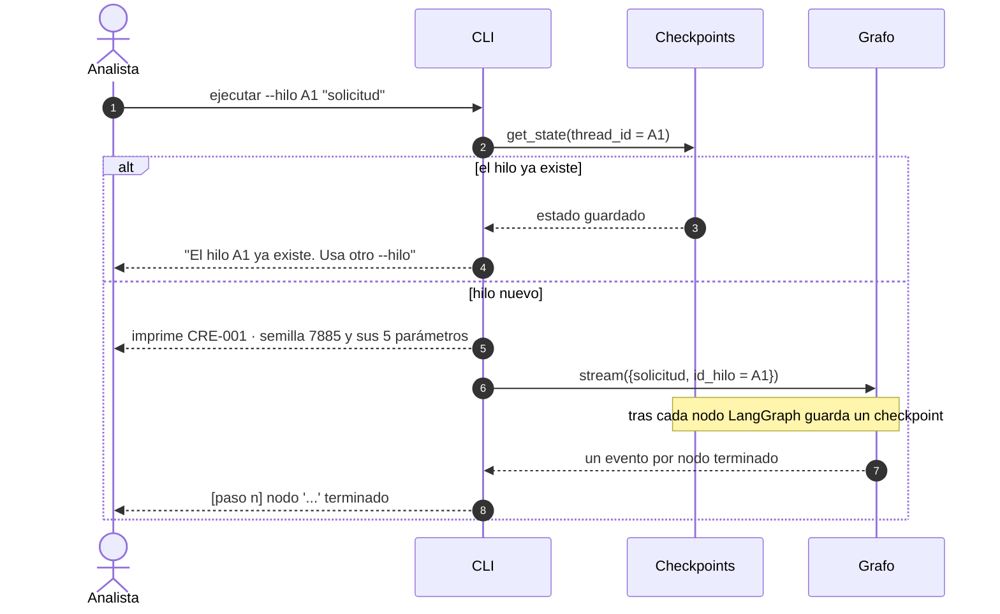
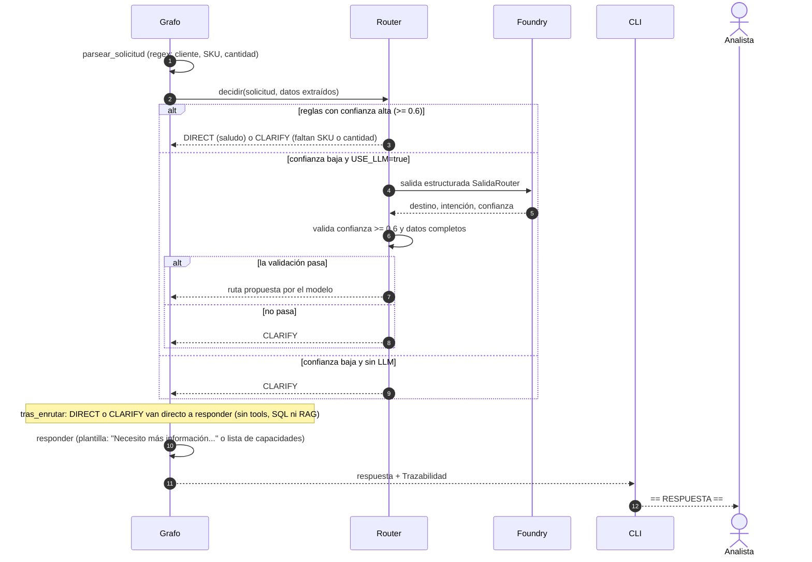
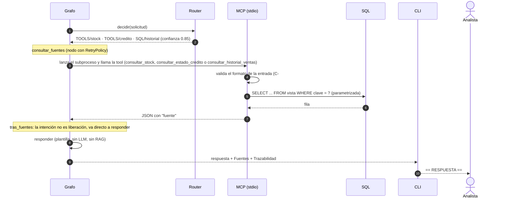
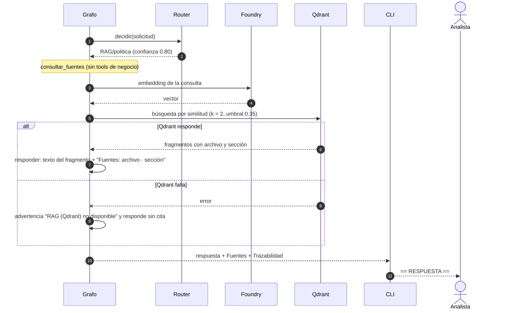
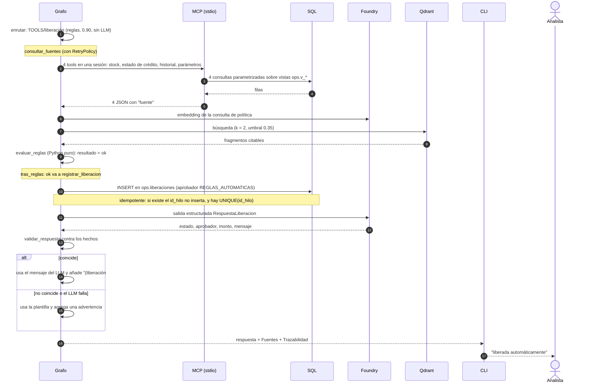
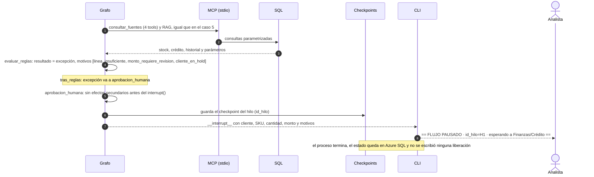
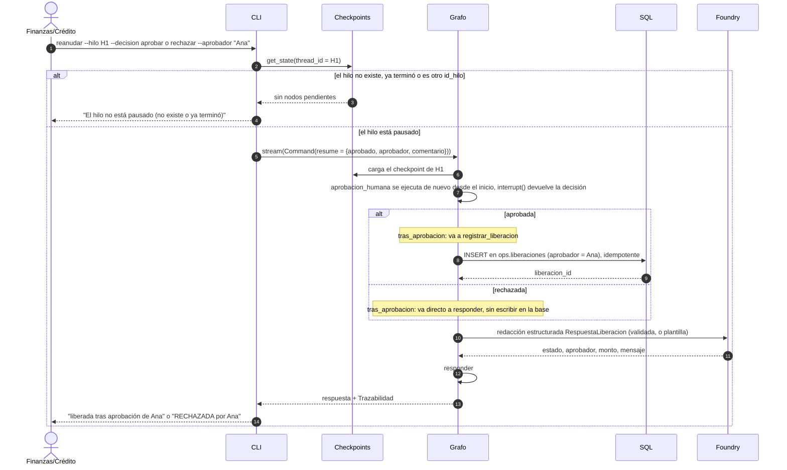
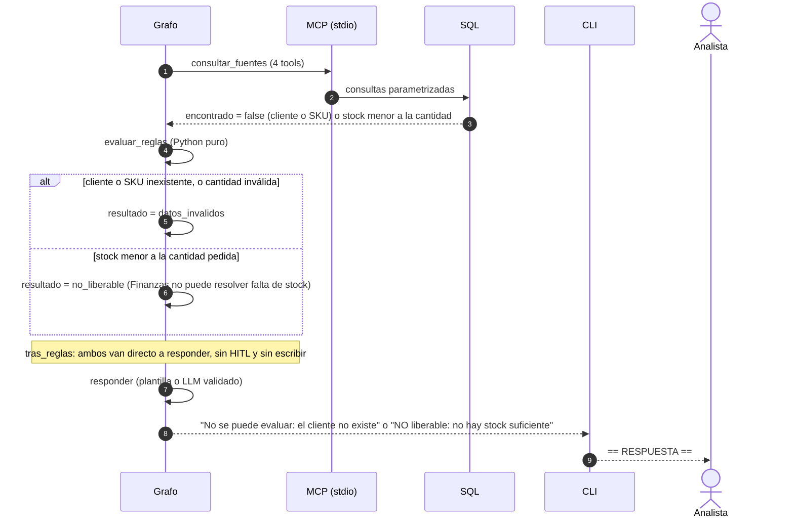
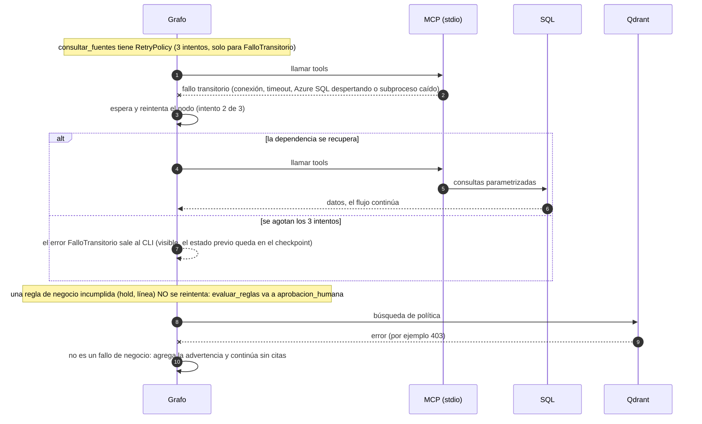

# AI Operations Agent · CRE-001 (Crédito) · semilla 7885

Agente de liberación de ventas a crédito sobre **Azure AI Foundry** (chat + embeddings), **Azure SQL** (datos de negocio), **Qdrant** (RAG de políticas), **LangGraph** (workflow con HITL) y **MCP** stdio (capacidades de solo lectura).

## Requisitos
- Python 3.11+, [ODBC Driver 18 for SQL Server](https://learn.microsoft.com/sql/connect/odbc/download-odbc-driver-for-sql-server)
- Azure: base Azure SQL y un recurso Azure AI Foundry con 2 deployments (chat, p. ej. `gpt-5-mini`; embeddings, p. ej. `text-embedding-3-small`). `AZURE_OPENAI_ENDPOINT` es el endpoint **del recurso** (`https://<recurso>.openai.azure.com/`), no el del proyecto.
- Qdrant: Qdrant Cloud (`QDRANT_URL` + `QDRANT_API_KEY`) o local con `docker run -p 6333:6333 qdrant/qdrant`
- Autenticación: `az login` (Microsoft Entra ID por `DefaultAzureCredential`) o claves/usuario SQL en `.env`. **No subas `.env` al repositorio.**

## Puesta en marcha
```powershell
uv sync --extra dev          # o: python -m venv .venv; .venv\Scripts\activate; pip install -e ".[dev]"
copy .env.example .env       # completar endpoints y deployments
uv run andes-init-db         # esquema ops + datos de prueba + parámetros de la semilla en Azure SQL
uv run andes-index           # embeddings en Foundry -> colección en Qdrant
```
Opcional: ejecutar `sql\03_permisos.sql` para crear los roles de mínimo privilegio.

## Demo
```powershell
uv run andes-demo ejecutar --hilo H1                                   # caso base: se pausa (HITL)
uv run andes-demo reanudar --hilo H1 --decision aprobar --aprobador "Ana (Finanzas)"
uv run andes-demo reanudar --hilo H1 --decision rechazar               # (en otro hilo pausado)
uv run andes-demo ejecutar --hilo H2 "C-1001 pide 2 EDGE-ORIN a crédito"   # ruta directa
uv run andes-mcp-cliente                                               # cliente MCP puro, sin LLM
```
- `SIMULAR_FALLOS_FUENTES=2` en `.env` provoca 2 fallos transitorios y muestra el `RetryPolicy`.
- `USE_LLM=false` desactiva Foundry para el chat (router por reglas, respuesta por plantilla).
- `--directo` consulta Azure SQL sin pasar por MCP. El recorrido lo indica en `[consultar_fuentes] canal de acceso: ...` (MCP por stdio o acceso directo a Azure SQL).
- `ejecutar` y `reanudar` imprimen el recorrido del grafo nodo por nodo (`[paso n] nodo '...' terminado`); `--sin-progreso` lo oculta.
- Cada `ejecutar` necesita un `--hilo` nuevo; `uv run andes-init-db --limpiar-demo` borra liberaciones e hilos de demos anteriores.
- Guion completo de comandos para el video: [GUIA_EXPOSICION.md](./GUIA_EXPOSICION.md).

## Pruebas
```powershell
uv run pytest        # 77 pruebas; no requieren Azure ni Qdrant (conexiones simuladas, Qdrant en memoria, servidor MCP de prueba por stdio)
```

## Estructura
| Ruta | Contenido |
|---|---|
| `sql/` | `01_schema.sql` (tablas + vistas), `02_seed.sql` (datos), `03_permisos.sql` (roles), `04_checkpoints.sql` (tablas del checkpointer) |
| `data/politicas/` | 3 documentos de política para RAG |
| `src/andes_agent/` | `config_caso`, `reglas`, `router`, `rag`, `db`, `foundry`, `graph`, `checkpointer`, `mcp_server`, `mcp_client`, `demo`… |
| `tests/` | reglas, router (14 casos), RAG, SQL, workflow, checkpointer, MCP y agente-MCP |
| `docs/` | `consulta_capacidad.md` (Hito 1), `arquitectura.md` (incluye antes/después de MCP), `workflow_state.md` (diagrama y State) |
| `HITOS.md`, `EVIDENCIAS.md`, `DECISIONES.md`, `USO_IA.md` | documentación del proceso |
| `CHECKLIST.md` | validación contra el checklist del PDF |

## Diagramas de secuencia por caso

Los diagramas usan Mermaid (se ven en GitHub o en VS Code con una extensión de Mermaid). Cada caso indica el comando que lo ejecuta. Participantes comunes:

- **CLI** = `andes-demo` · **Grafo** = LangGraph (`graph.py`) · **Router** = `router.py`
- **MCP** = servidor MCP de solo lectura (subproceso por stdio) · **SQL** = Azure SQL (`ops.*`)
- **Qdrant** = RAG de políticas · **Foundry** = Azure AI Foundry (embeddings y `gpt-5-mini`)
- **Checkpoints** = tablas `lg.*` de Azure SQL, donde LangGraph guarda el estado tras cada nodo

| # | Caso | Ejemplo | Destino del router |
|---|---|---|---|
| 1 | Arranque y errores de hilo | `ejecutar --hilo A1 ...` | (común a todos) |
| 2 | Sin fuentes: saludo, aclaración, baja confianza | `"Hola, ¿qué puedes hacer?"`, `"Libera la venta de C-1003"`, `"necesito algo urgente"` | `DIRECT` / `CLARIFY` |
| 3 | Consulta informativa con tools o SQL | `"¿Cuánto stock hay de EDGE-ORIN?"` | `TOOLS` / `SQL` |
| 4 | Política con RAG | `"¿Qué dice la política cuando un cliente está en hold?"` | `RAG` |
| 5 | Liberación automática | `"C-1001 pide 2 EDGE-ORIN a crédito"` | `TOOLS` (liberación) |
| 6 | Excepción: pausa (HITL) | caso base, `"C-1004 pide 1 EDGE-ORIN a crédito"` | `TOOLS` (liberación) |
| 7 | Reanudación: aprobar, rechazar o error | `reanudar --hilo H1 --decision ...` | (continúa el hilo) |
| 8 | Sin escalar: datos inválidos o stock insuficiente | `"C-9999 pide 2 EDGE-ORIN"`, `"C-1001 pide 500 EDGE-ORIN"` | `TOOLS` (liberación) |
| 9 | Fallos técnicos: retry y degradación | `SIMULAR_FALLOS_FUENTES=2` | (cualquiera con fuentes) |

### 1. Arranque y errores de hilo


### 2. Sin fuentes: saludo, aclaración y baja confianza


### 3. Consulta informativa con tools o SQL (stock, crédito, historial)


### 4. Política con RAG


### 5. Liberación automática (sin excepción)


### 6. Excepción: el flujo se pausa (HITL)
Ocurre con cliente en hold, línea insuficiente o monto ≥ monto de revisión.


### 7. Reanudación: aprobar, rechazar o error


### 8. Sin escalar: datos inválidos o stock insuficiente


### 9. Fallos técnicos: retry y degradación


## Notas de diseño
- Las reglas de crédito son Python determinista; el LLM solo enruta (con validación posterior) y redacta.
- El servidor MCP solo lee **vistas** (`ops.v_*`); la única escritura (`ops.liberaciones`) la hace el agente después del `interrupt()` y es idempotente por `UNIQUE(id_hilo)`.
- El estado de los hilos pausados (checkpoints de LangGraph) vive en Azure SQL, esquema `lg` (`sql/04_checkpoints.sql`), mediante `AzureSqlSaver` (`checkpointer.py`). Así `ejecutar` y `reanudar` funcionan desde cualquier máquina o instancia, sin archivos locales.
- Si ya habías ejecutado `andes-init-db` antes de este cambio, crea solo las tablas nuevas con `andes-init-db --solo-checkpoints` (no borra datos).
