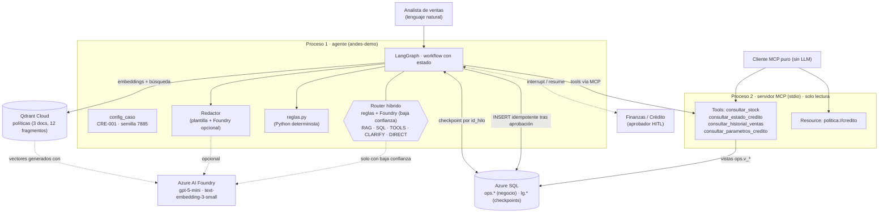
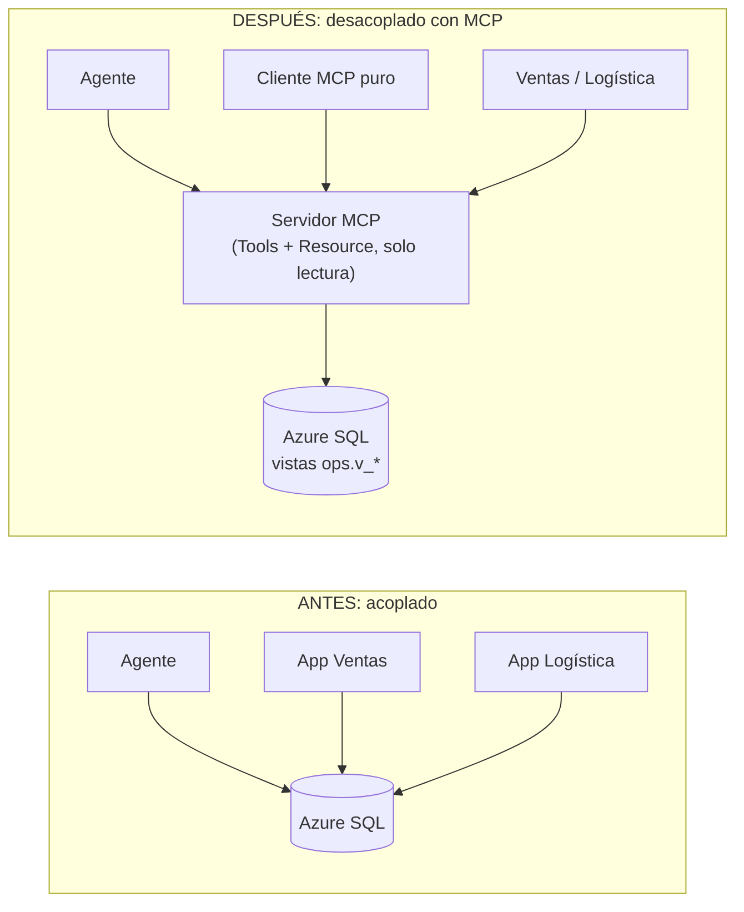
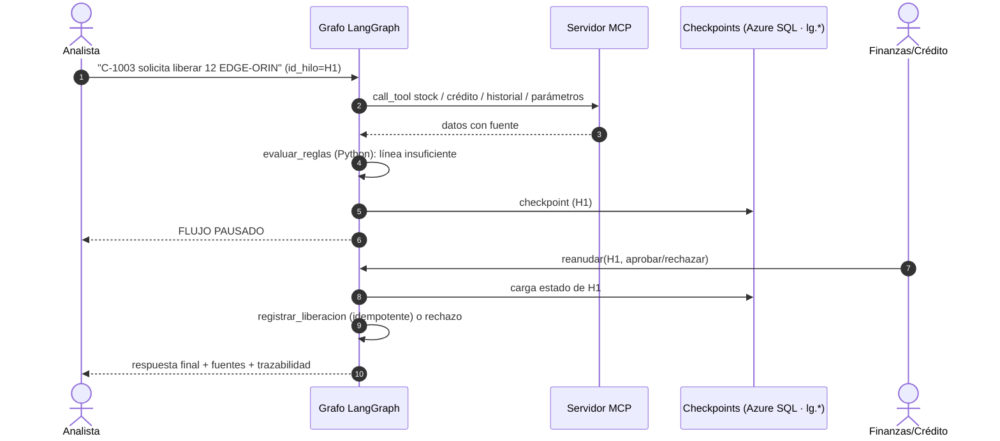

# Arquitectura · AI Operations Agent · CRE-001 (Crédito) · semilla 7885

## 1. Vista general

## 2. Qué decide cada componente

| Componente | Tipo de decisión | Detalle |
|---|---|---|
| `reglas.py` | **Determinista** | línea insuficiente, hold, monto ≥ monto de revisión, stock, datos inválidos. Nunca el LLM. |
| Router | **Semántica** | Reglas primero; Foundry solo con confianza < 0.6, con salida validada (Pydantic) y comprobación de datos completos. |
| LangGraph | **Proceso** | qué nodo sigue, qué estado persiste, pausa y reanudación. |
| MCP | **Integración** | stock, crédito, historial y política como capacidades reutilizables y de solo lectura. |
| Redactor (Foundry) | Probabilístico | redacta el mensaje de las liberaciones con salida estructurada; el código valida estado, aprobador y monto y, si no coinciden, usa la plantilla. No controla ramas ni decisiones. |

## 3. Antes / después de MCP

- **Antes:** cada consumidor repite el acceso a la base y queda atado al esquema.
- **Después:** un contrato único, de mínimo privilegio, reutilizable por cualquier cliente MCP.

### Qué se expone por MCP y qué no

| Se expone (solo lectura, acotado) | NO se expone |
|---|---|
| `consultar_stock(sku)` | `ejecutar_sql(sql)` (SQL libre) |
| `consultar_estado_credito(cliente_id)` | Aprobar o liberar ventas (decisión humana + reglas) |
| `consultar_historial_ventas(cliente_id)` | Modificar límites de crédito |
| `consultar_parametros_credito()` | Datos de otros clientes sin necesidad |
| Resource `politica://credito` | |

> Un *Resource* informa, no autoriza: la autorización sigue siendo de las reglas y del aprobador humano.

## 4. Pausa y reanudación (HITL)

El diagrama del workflow y la explicación del State están en [workflow_state.md](./workflow_state.md).
