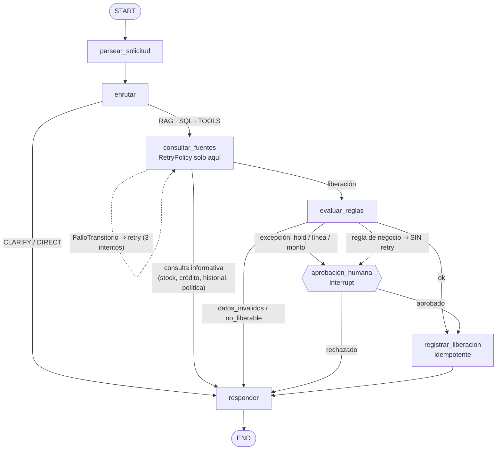

# Workflow (LangGraph) y State

## Diagrama

- **Nodos (7):** `parsear_solicitud`, `enrutar`, `consultar_fuentes`, `evaluar_reglas`, `aprobacion_humana`, `registrar_liberacion`, `responder`.
- **Conditional edges (4):** tras `enrutar`, `consultar_fuentes`, `evaluar_reglas` y `aprobacion_humana`.
- **Rutas que terminan directamente** (sin HITL): saludo (`DIRECT`), aclaración (`CLARIFY`), consultas informativas, datos inválidos, stock insuficiente y liberación automática.
- **Retry:** solo `consultar_fuentes` y solo para `FalloTransitorio` (red, Azure SQL reanudando, proceso MCP caído).
- **Checkpoint:** `AzureSqlSaver` guarda el estado en `lg.checkpoints` / `lg.writes` por `id_hilo` (thread_id).

## Explicación de cada campo del State

Definido en `src/andes_agent/graph.py` (`Estado`). Es pequeño a propósito: solo lo que debe sobrevivir entre nodos.

| Campo | Qué guarda | Por qué sobrevive |
|---|---|---|
| `id_hilo` | Identificador del hilo | Clave de checkpoint, de reanudación y de idempotencia de la liberación. |
| `solicitud` | Texto original | El router y el nodo de política lo reutilizan. |
| `cliente_id`, `sku`, `cantidad` | Datos extraídos por el parser | Los usan las tools, las reglas y la liberación. |
| `destino`, `intencion`, `confianza` | Resultado del router | Deciden las ramas y se muestran en la trazabilidad. |
| `evidencia` | Respuestas de las tools y fragmentos de política citados (con fuente) | Las reglas y la respuesta final se basan en ella. |
| `decision` | Resultado de `evaluar_reglas`: `resultado`, `motivos`, `monto`, `exposicion`, `limite` | Define la rama (HITL, registrar, responder). |
| `aprobacion` | Decisión humana: `aprobado`, `aprobador`, `comentario` | Decide si se registra la liberación. |
| `liberacion` | `liberacion_id` y si fue creada | Muestra el resultado del efecto de negocio. |
| `respuesta` | Texto final con fuentes y trazabilidad | Salida para el analista. |
| `advertencias` | Lista (acumulativa) | Degradaciones, p. ej. "RAG no disponible". |
| `traza` | Lista (acumulativa) de pasos | Trazabilidad y auditoría. |

### Qué NO se guarda en el State (y por qué)
- **Secretos, tokens o cadenas de conexión:** peligroso; podrían quedar persistidos en el checkpoint.
- **Documentos de política completos:** solo se guardan los fragmentos citados.
- **Conexiones, clientes o el servidor MCP:** no son serializables y se reconstruyen en cada proceso.
- **Historiales completos de ventas:** crecen sin límite. *Mejora pendiente:* hoy `evidencia.historial` guarda las últimas 5 ventas y el resumen de pagos; para producción se reduciría solo al resumen.
- **Texto intermedio de los prompts del LLM:** ruido y riesgo de datos sensibles.

### ¿Por qué no basta una cadena de if/else?
Porque el proceso necesita **pausarse días** esperando a una persona y **continuar exactamente donde quedó**, con otro proceso o máquina si hace falta. Un if/else vive y muere con la ejecución; el workflow con checkpoint persiste el estado, reintenta solo lo técnico y deja trazabilidad de cada paso.
